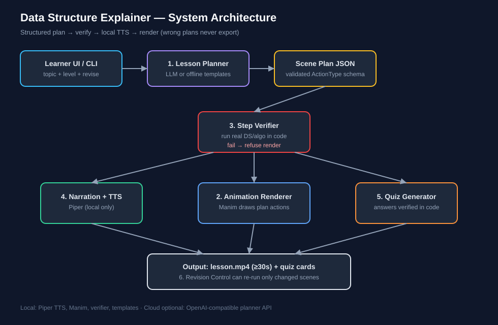
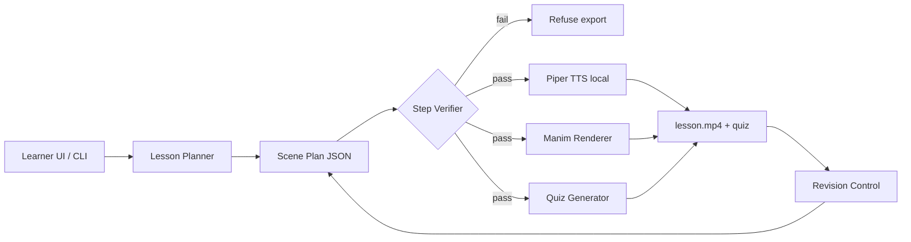

# Data Structure Explainer

**Project 1 — Data Structure Explainer**  
Narrated DSA video lessons from a typed topic: plan → **verify** → local Piper voice → Manim render → quiz.  
Wrong plans are refused — a wrong video is worse than no video.

**GitHub:** https://github.com/zain003/DSA-Explainer_Animation  

**Demo video (Loom):** _[paste your 2–3 minute Loom URL here after recording — see `docs/LOOM_DEMO_SCRIPT.md`]_  

**Report:** [`docs/REPORT.md`](docs/REPORT.md) · **Architecture diagram:** [`docs/architecture.svg`](docs/architecture.svg)

---

## 1. Group members

| Name | Registration number | Role (optional) |
|------|---------------------|-----------------|
| _Member 1 — replace with full name_ | _Reg. No._ | |
| _Member 2 — replace with full name_ | _Reg. No._ | |
| _Member 3 — replace with full name_ | _Reg. No._ | |
| _Member 4 — replace with full name_ | _Reg. No._ | |

> Replace the placeholder rows with your group’s real names and registration numbers before final submission.

---

## 2. What we built, models / APIs, and what runs locally

### Project
**Project 1: Data Structure Explainer** — a product that teaches linked lists, stacks, queues, trees, graph BFS, and bubble sort through generated narrated videos (≥ 30 seconds) with an end-of-lesson quiz and revision control (“slow down step 4”, “explain it for a beginner”).

### Models and APIs
| Component | Technology | Required? |
|-----------|------------|-----------|
| Lesson / narration planning | **OpenAI-compatible Chat API** (e.g. `gpt-4o-mini` via `OPENAI_API_KEY`) | Optional |
| Offline planning | Deterministic **verified templates** (no API) | Default for demos |
| Text-to-speech | **Piper** (`piper-tts`, voice `en_US-lessac-medium`) | Required (local) |
| Animation | **Manim Community** + **FFmpeg** | Required (local) |
| Learner UI | **Gradio** + **Typer** CLI | Local |

### What runs locally vs in the cloud
- **Local:** scene-plan validation, step verifier (real DS/algo code), Piper TTS, Manim rendering, quiz checks, revision, Gradio/CLI.
- **Cloud (optional only):** LLM calls for planning / narration polish. Use `--offline` / UI “Offline templates” to run with **zero cloud calls**.

---

## 3. Architecture (short) + diagram

The language model (or templates) must **not** draw freely. It emits a structured JSON `LessonPlan`. The **step verifier** executes the true data structure and compares `expected_state`. Only then do **Piper** and **Manim** produce audio and video. **Revision** rewrites targeted scenes and re-runs verification.





### Core modules
1. **Lesson planner** — topic + level → validated JSON plan  
2. **Animation renderer** — Manim draws `ActionType` actions only  
3. **Step verifier** — real code checks every step  
4. **Narration + local TTS** — Piper  
5. **Quiz generator** — verified answers  
6. **Revision control** — partial re-plan / re-render  

Full write-up and Critical Analysis: [`docs/REPORT.md`](docs/REPORT.md).

---

## Covered topics

| Kind | Example prompt |
|------|----------------|
| `linked_list` | how does a linked list work |
| `stack` | explain stacks |
| `queue` | how does a queue work |
| `tree` | show binary search trees |
| `graph_bfs` | show BFS on this graph |
| `sorting` | explain bubble sort |

---

## Setup

```bash
git clone https://github.com/zain003/DSA-Explainer_Animation.git
cd DSA-Explainer_Animation
python -m venv .venv
# Windows:
.venv\Scripts\activate
pip install -e ".[dev]"
copy .env.example .env

# Local Piper voice (~63 MB)
python -m piper.download_voices en_US-lessac-medium --data-dir assets/voices
```

Install **FFmpeg** on PATH (e.g. `winget install Gyan.FFmpeg`).

---

## Usage

```bash
# Web UI
dsa-explainer ui
# → http://127.0.0.1:7860

# CLI full lesson
dsa-explainer generate "how does a queue work" --offline

# Plan + verify only
dsa-explainer plan "show BFS on this graph" --offline

# Revise one part
dsa-explainer revise output/lessons/<lesson-id> "slow down step 4"

# Tests
pytest -q
```

Artifacts: `output/lessons/<id>/plan.json`, `verification.json`, `audio/`, `lesson.mp4`.

---

## Submission checklist

- [x] Full code in GitHub  
- [x] Documentation (`README.md`, `docs/REPORT.md`)  
- [x] Tests (`tests/`, pytest)  
- [x] System architecture diagram (`docs/architecture.svg` + mermaid above)  
- [ ] Group member names + registration numbers filled in the table above  
- [ ] 2–3 minute Loom demo recorded and link pasted at the top (`docs/LOOM_DEMO_SCRIPT.md`)  

---

## License / third-party

Piper voices and optional OpenAI API use are subject to their respective licenses and terms. Voice model files are downloaded locally and are not required to be committed to the repo.
